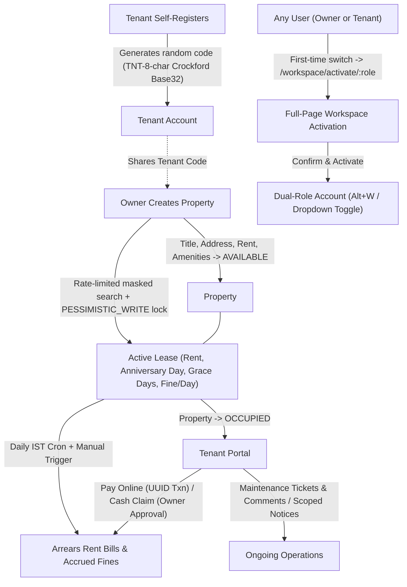

# Smylio — Tenant–Owner Management (TOM)

> **Renting Made Happier** · Full-Stack Property, Lease, Billing, Maintenance & Dual-Role Workspace Operations Platform

Smylio (TOM) is an **owner-managed, closed operational platform** for landlords and tenants—**not** a public property marketplace. Property owners manage properties, link verified tenants via non-guessable tenant codes, automate monthly arrears rent billing and late fines, approve cash claims, track maintenance discussion threads, and publish broadcast or unit-targeted notices.

Smylio supports **Dual-Role Workspace Architecture**: users can hold both Landlord and Tenant capabilities under a single account, switching instantaneously between workspaces (`Alt + W`) with cross-workspace alert badges, contextual identity attribution, and zero data mingling.

---

## Core Flow



---

## Architecture & Engineering Highlights

Designed as a production-hardened Spring Boot 3.3.5 + React 18 monolith packaged into a unified container:

- **Dual-Role Workspace Architecture & Seamless Switching:**
  - **Normalized Roles:** Users can hold multiple roles stored in a dedicated `user_roles` collection table (`user_id`, `role`) mapped via JPA `@ElementCollection` and `@CollectionTable`.
  - **Active Session Tracking:** The user's active workspace role is tracked in `users.role` and encoded into the 15m JWT, ensuring backward compatibility and session persistence across page refreshes.
  - **Instant Role Switch:** `POST /api/auth/switch-role` toggles active roles within milliseconds, returning a fresh 15m JWT (Bucket4j rate-limited to 30/min).
  - **Dedicated Full-Page Activation:** First-time workspace switching navigates to a dedicated full-page view (`/workspace/activate/:role`) featuring role benefits, guarantee cards, and `POST /api/profile/roles/activate` (allocates a Crockford Base32 tenant code if activating tenant mode; Bucket4j rate-limited to 5/hr).
  - **Cross-Workspace Badges:** `GET /api/me/badges` returns real-time pending counts for the inactive workspace (`ownerPendingApprovals`, `ownerOpenTickets`, `tenantPendingRents`, `tenantUnreadNotices`), displayed directly inside the sidebar dropdown.
  - **Multi-Tab Session Synchronization:** Uses the HTML5 `BroadcastChannel('smylio_auth')` API to notify open sibling tabs upon workspace switches, preventing 401/403 race conditions.
  - **Keyboard Shortcut:** `Alt + W` toggles between Owner Workspace and Tenant Portal instantly for dual-role accounts.

- **Hardened Defensive Guards & Attribution:**
  - **Early Self-Search Guard:** `TenantController` / `TenantService.searchByTenantCode` returns `400 Bad Request` if an owner searches their own tenant code.
  - **Self-Leasing Guard:** `LeaseService.create` prevents creating a lease where the owner and tenant are the same user.
  - **Contextual Comment Attribution:** `MaintenanceService.toCommentResponse` computes comment author roles from property ownership rather than mutable active session roles, ensuring audit histories remain accurate regardless of workspace toggles.

- **Short-Lived JWT + Rotating Refresh Cookie Auth:**
  - `15m` (`900s`) HS256 Bearer JWT stored **in React memory only** (never `localStorage`), carrying user details and the full `roles` array.
  - `256`-bit opaque refresh tokens stored as SHA-256 hex hashes in `refresh_tokens`, delivered via an `HttpOnly; SameSite=Strict; Path=/api/auth` cookie.
  - Single-use token rotation on `POST /api/auth/refresh` with **reuse detection** (replaying an old token revokes the entire `family_id`), `POST /api/auth/logout` revocation, and single-flight Axios `401` retry.
  - Password change immediately revokes all active refresh tokens for the user across all devices, while issuing a fresh replacement cookie for the active session.
  - Automated daily 03:00 IST scheduled task (`RefreshTokenService.purgeStaleTokens`) purges revoked and expired refresh tokens older than 14 days.

- **Constant-Time Auth & Abuse Protection:**
  - BCrypt (cost 12) password hashing with no plaintext fallback and dummy BCrypt verification when an email does not exist to mitigate timing-based account enumeration.
  - Eviction-safe Bucket4j rate limiting: protects active penalty buckets from cache eviction, covering `POST /api/auth/login`, `POST /api/auth/register`, `POST /api/auth/switch-role`, `POST /api/profile/roles/activate`, `GET /api/tenants/search`, `PUT /api/profile/password`, `POST /api/maintenance`, `POST /api/maintenance/*/comments`, and `POST /api/notices`.
  - Registration conflict sanitization returning generic messages to mitigate user account enumeration.
  - Tomcat `RemoteIpValve` with RFC1918 internal proxy filtering and configurable `TRUSTED_PROXIES` for accurate real client IP rate limiting behind reverse proxies (Render, Cloudflare, ALB).
  - Tenant registration generates random `TNT-` + 8 Crockford Base32 codes (`SecureRandom`), and tenant search exposes only `name`, `maskedPhone`, and `tenantCode`.

- **Concurrency-Safe Leases & Rent Payments:**
  - Lease creation acquires a `PESSIMISTIC_WRITE` lock on the parent `Property` row (`SELECT ... FOR UPDATE`) to serialize concurrent lease assignments.
  - All rent payment state transitions (`payOnline`, `payCash`, `approveCash`, `rejectCash`) execute atomic conditional `@Modifying` `UPDATE ... WHERE status IN (...)` queries (`0` rows updated → `409 Conflict`).

- **Deterministic IST Arrears Billing & Proration:**
  - Injects an `Asia/Kolkata` `Clock` bean across all services and schedules daily billing at `00:00 IST`.
  - Handles month-end clamping (`LocalDate.plusMonths`), mid-cycle lease-end proration (`monthlyRent × daysOccupied / daysInCycle`, `RoundingMode.HALF_UP`), unified fine freezing on payment/cash-claim, and restoring `LATE` + accrued fine when an overdue cash claim is rejected.
  - All monetary values use `BigDecimal` / `DECIMAL(10, 2)`.

- **Zero-Trust Data Isolation & Observability:**
  - Dual-layer security: Spring Security route/role matchers (`ROLE_OWNER` / `ROLE_TENANT`) + row-level ownership scoping in JPA repositories (`ownerId` / `tenantId` extracted exclusively from the verified JWT subject).
  - Defense-in-depth headers: `Content-Security-Policy` (CSP), `Permissions-Policy`, and `X-Frame-Options: DENY`.
  - CSRF defense: `AuthOriginValidatorFilter` on cookie endpoints verifying that `Host` strictly matches `request.getServerName()`.
  - Domain enums (`@Enumerated(EnumType.STRING)`), `CorrelationIdFilter` (`X-Request-Id` in response headers and SLF4J MDC logs), centralized `GlobalExceptionHandler`, and CORS disabled in production (`dev` profile only).

- **Modern Accent Border Line Notification System:**
  - All notification, error, warning, and info alerts feature a **4px vertical accent border line indicator** (`border-left: 4px solid ...`) using semantic theme tokens (`--success`, `--danger`, `--warning`, `--accent`).
  - Integrated Lucide status icons (`<CheckCircle2 />`, `<AlertCircle />`, `<AlertTriangle />`, `<Info />`), interactive dismiss button (`✕`), and an animated bottom timer bar (`.alert-progress-line`).
  - Workspace switch notification banner: `"Switched to Owner Workspace."` / `"Switched to Tenant Portal."` auto-dismissing at the top of the content pane.

---

## System Design & Key Decisions

| Decision | Why This Choice (Trade-off) |
|---|---|
| **Dual-Role normalized `user_roles`** | Normalizes roles into a collection table (`user_roles`) while tracking active role in `users.role`; allows landlords and tenants to share one account without data pollution. |
| **Contextual comment attribution** | Maintenance comments evaluate property ownership (`comment.property.ownerId == comment.userId`) rather than mutable session roles, preserving audit trail accuracy. |
| **`leases` as the normalized link** | Properties and tenants never share a static FK; `leases` preserves multi-tenancy history, billing terms, and audit trails when a property flips back to `AVAILABLE`. |
| **Computed dues vs. stored `total_due`** | Avoids denormalized balance drift and concurrent update races; unpaid `rent_payments` rows (`PENDING`, `LATE`, `AWAITING_APPROVAL`) are the single source of truth summed server-side. |
| **Conditional `UPDATE`s & `FOR UPDATE` locks** | Payment transitions execute `UPDATE ... WHERE status IN (...)` (`0` rows → `409 Conflict`), and lease creation locks the `Property` row (`PESSIMISTIC_WRITE`) instead of fragile Java read-then-write checks. |
| **In-memory 15m JWT + SHA-256 refresh cookies** | Eliminates `localStorage` JWT XSS exposure; hashed refresh tokens allow server-side logout revocation and `family_id` replay detection (persisted with `@Transactional(noRollbackFor = ...)`). |
| **Injected `Asia/Kolkata` `Clock` & arrears model** | Bills per lease anniversary day with month-end clamping and mid-cycle proration; injecting `Clock` prevents UTC/IST date drift on cloud hosts and makes edge-case tests deterministic. |
| **Database-first `ddl-auto=validate`** | Fails fast at boot on schema/entity drift without letting Hibernate run uninspected DDL in production. |
| **Single-container SPA + `SpaController`** | Serves React static assets and `/api/**` from one origin so production runs with CORS disabled and `SameSite=Strict` cookies work cleanly without cross-origin friction. |
| **Accent border indicator styling** | 4px vertical accent lines provide immediate semantic status clarity and high contrast in both dark and light modes without heavy background tint fatigue. |

---

## Tech Stack

| Layer | Technologies |
|---|---|
| **Backend** | Java 17 LTS, Spring Boot 3.3.5, Spring Web, Spring Security 6 (OAuth2 Resource Server), Bean Validation, Spring Boot Actuator |
| **Data & ORM** | Hibernate 6, Spring Data JPA, HikariCP, Supabase PostgreSQL (`sslmode=require`, `ddl-auto=validate`) |
| **Security & Rate Limiting** | Nimbus HS256 JWT, `httpOnly` rotating refresh tokens, BCrypt (cost 12), Bucket4j 8.10.1 |
| **Frontend** | React 18, TypeScript 5.6, Vite 6, React Router 6, Axios, Lucide React, Custom CSS variables (Dark/Light theme) |
| **Build, CI/CD & Hosting** | Maven Wrapper, Multi-stage [Dockerfile](Dockerfile) (Node 22 + Maven/Temurin 17 + JRE 17 Alpine), GitHub Actions, Render |

---

## Features by Portal

### Workspace Switcher & Activation
- **Switcher Dropdown:** Located at the top of the sidebar. Displays active workspace (`✓ Active`) and pending badge alerts for the other workspace (`1 pending`, `rent due`, etc.).
- **Topbar Workspace Badge & Quick Switch:** Shows current active workspace (`👑 Owner Workspace` or `🏠 Tenant Portal`) and an `Alt + W` quick switch button.
- **Activation Page (`/workspace/activate/:role`):** Full-page view inside the main content shell with role benefits, data safety guarantees, and a single "Confirm & Activate" button.
- **Multi-Tab Sync:** Uses `BroadcastChannel('smylio_auth')` to sync workspace switches across all open browser tabs.

### Owner Workspace (`/owner/**`)
- **Overview:** Active tenant count, total outstanding rent (including accrued fines & pending cash claims), open maintenance count, and cash payment approval inbox.
- **Properties:** CRUD with normalized/deduplicated amenities (`@ElementCollection`), `AVAILABLE`/`OCCUPIED` badges, and `409` delete protection when lease/ticket/notice history exists.
- **Tenants & Leases:** Rate-limited masked tenant code lookup, property-locked lease creation with self-leasing guards, active-only term updates, lease termination with automatic mid-cycle final billing, and per-tenant historical deep dive.
- **Rent & Notices:** Manual arrears billing trigger, per-lease payment logs, cash claim accept/reject, and broadcast or property-targeted notices.
- **Maintenance:** Paginated/searchable issue hub, `OPEN` → `IN_PROGRESS` → `RESOLVED` transitions, and contextual discussion comments.

### Tenant Portal (`/tenant/**`)
- **My Home:** Non-guessable tenant ID copy/share card, active lease & amenities view, landlord contact details, current balance, recent notices, and celebratory hero banner upon role activation.
- **Rent & Payments:** Computed dues breakdown, simulated online payment (UUID transaction ID), cash payment claim submission, and complete payment history.
- **Maintenance & Notices:** Raise tickets on active leases, edit non-closed tickets, cancel `OPEN` tickets, discuss via comment thread, and browse paginated/filtered owner notices.

---

## Data Model & API Summary

**PostgreSQL Tables (10):** `users`, `user_roles`, `refresh_tokens`, `properties`, `property_amenities`, `leases`, `rent_payments`, `maintenance_requests`, `maintenance_comments`, `notices`.

| Route Group | Purpose |
|---|---|
| `/api/auth/**` | Registration, rate-limited login, cookie-based token refresh (`POST /refresh`), logout revocation (`POST /logout`), and workspace switching (`POST /switch-role`) |
| `/api/profile/**` | View/edit profile, rate-limited password change with full-session refresh token revocation, and role activation (`POST /roles/activate`) |
| `/api/properties/**` | Owner property & amenity CRUD |
| `/api/tenants/**` | Rate-limited masked tenant search (`?code=...`) with self-search prevention, and owner-scoped tenant history |
| `/api/leases/**` | Lease creation (with self-leasing guard), active-lease term updates, and termination with prorated final billing |
| `/api/me/**` | Tenant self-service active leases, rent summary/history, visible notices, and cross-workspace badges (`GET /badges`) |
| `/api/rents/**` | Arrears billing trigger, atomic online/cash payments, owner cash approvals/rejections, lease logs |
| `/api/maintenance/**` | Paginated tickets, status updates, edits/cancellations, and contextual discussion comments |
| `/api/notices/**` | Owner broadcast/targeted notices CRUD and paginated feeds |
| `/actuator/health` | Sanitized health endpoint for Render readiness checks |

---

## Run Locally

**Prerequisites:** Java 17+, Node.js 22+, npm, and a Supabase PostgreSQL instance.

1. **Configure environment variables:** Copy [.env.example](.env.example) to `.env` (gitignored) and fill in your values (or export them in PowerShell):
   ```powershell
   $env:SUPABASE_JDBC_URL = "jdbc:postgresql://<host>:<port>/postgres?sslmode=require"
   $env:SUPABASE_DB_USERNAME = "<Supabase pooler username>"
   $env:SUPABASE_DB_PASSWORD = "<Supabase database password>"
   $env:JWT_SECRET = "<Base64-encoded random secret of at least 32 bytes>"
   ```
2. **Start the Spring Boot backend:**
   ```powershell
   .\mvnw.cmd spring-boot:run
   ```
   *(If calling `:8080` directly from `:5173` instead of using Vite's proxy, pass `-Dspring-boot.run.profiles=dev` to enable dev CORS.)*
3. **Start the React dev server (second terminal):**
   ```powershell
   cd frontend
   npm ci
   npm run dev
   ```
   Open `http://localhost:5173` — Vite proxies `/api/**` to `http://localhost:8080`.

---

## Build & Test

```powershell
# Backend unit test suite (100 unit & mock tests) + JAR package
.\mvnw.cmd -B "-Dtest=!TomApplicationTests,!SecurityIntegrationTest" verify

# Full backend suite including live-DB tests (requires DB env vars / .env)
.\mvnw.cmd test

# Frontend lint & production build
npm --prefix frontend run lint
npm --prefix frontend run build
```

---

## Docker & Render Deployment

The multi-stage [Dockerfile](Dockerfile) compiles the React bundle with Node 22, embeds it into `src/main/resources/static/`, packages the Spring Boot JAR, and runs it as a non-root user on port `8080` with `SpaController` forwarding React client routes (`/`, `/login`, `/register`, `/profile`, `/faq`, `/help`, `/workspace/activate/**`, `/owner/**`, `/tenant/**`).

```powershell
docker build -t tom-app .
docker run --rm -p 8080:8080 `
  -e SUPABASE_JDBC_URL="$env:SUPABASE_JDBC_URL" `
  -e SUPABASE_DB_USERNAME="$env:SUPABASE_DB_USERNAME" `
  -e SUPABASE_DB_PASSWORD="$env:SUPABASE_DB_PASSWORD" `
  -e JWT_SECRET="$env:JWT_SECRET" `
  tom-app
```

See [docs/DESIGN.md](docs/DESIGN.md) for the authoritative system architecture blueprint and [docs/GITHUB_ACTIONS_CICD.md](docs/GITHUB_ACTIONS_CICD.md) for the GitHub Actions CI pipeline and Render CI-gated deployment setup. Never commit `.env` files, database passwords, or JWT secrets.
