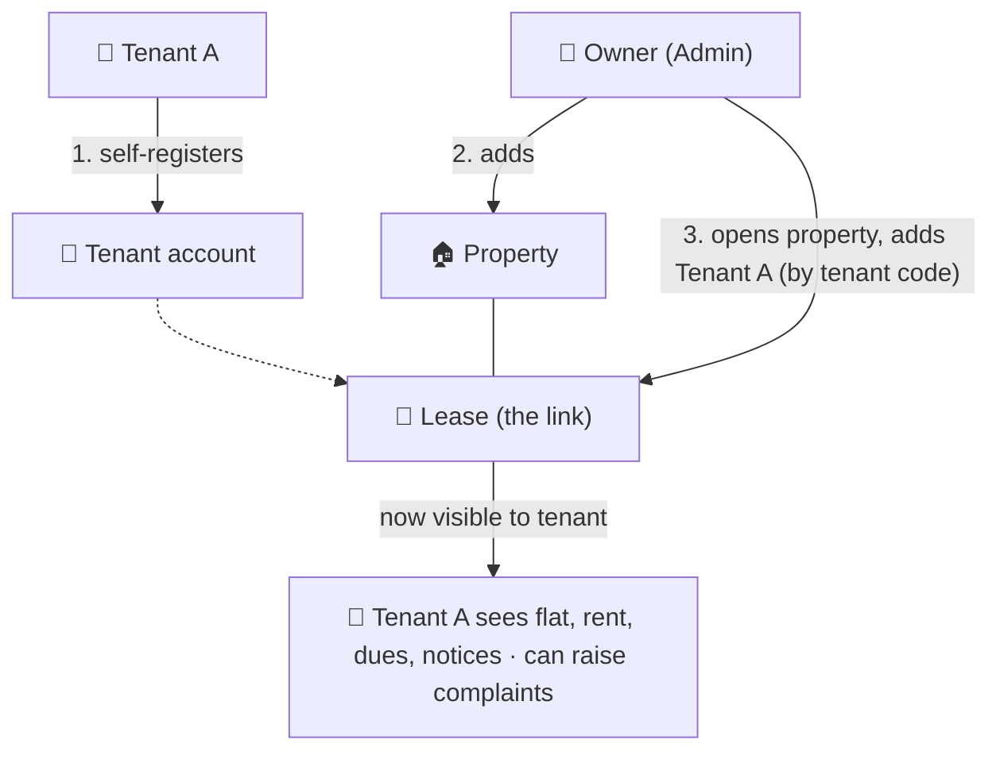
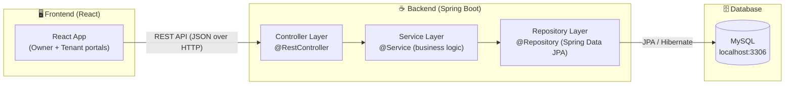
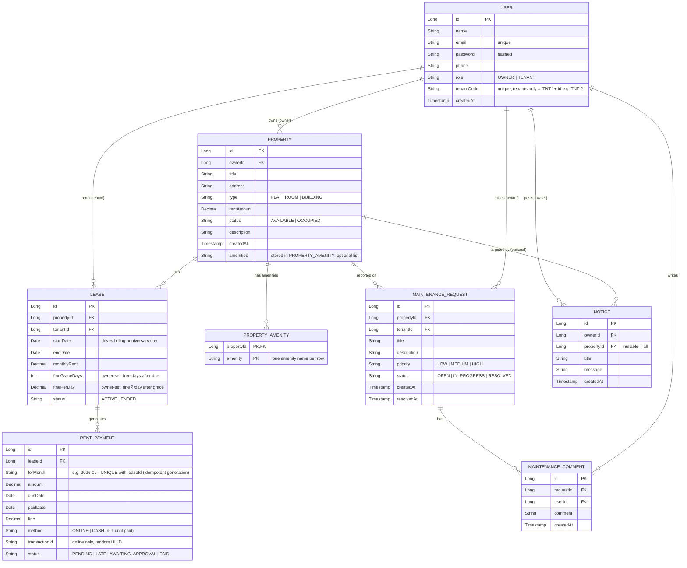
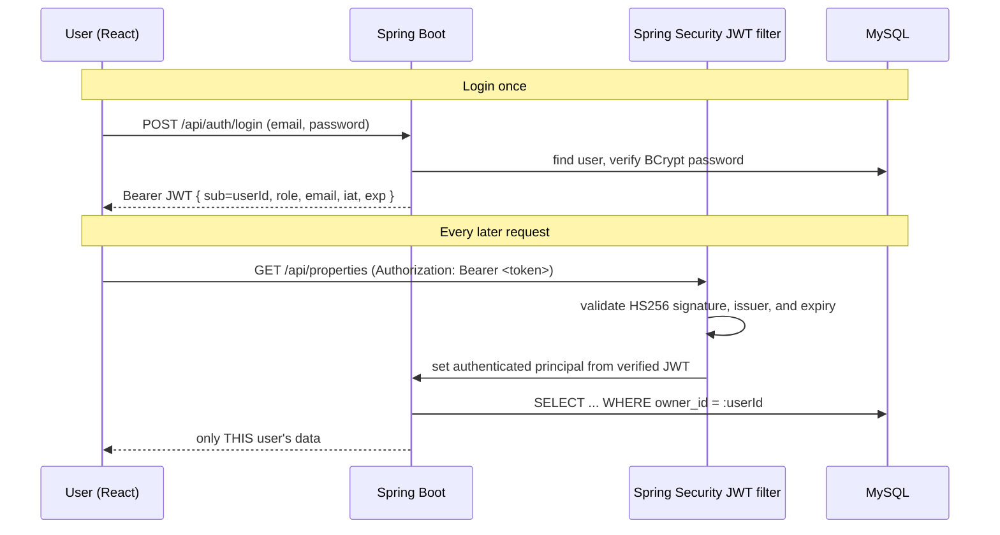
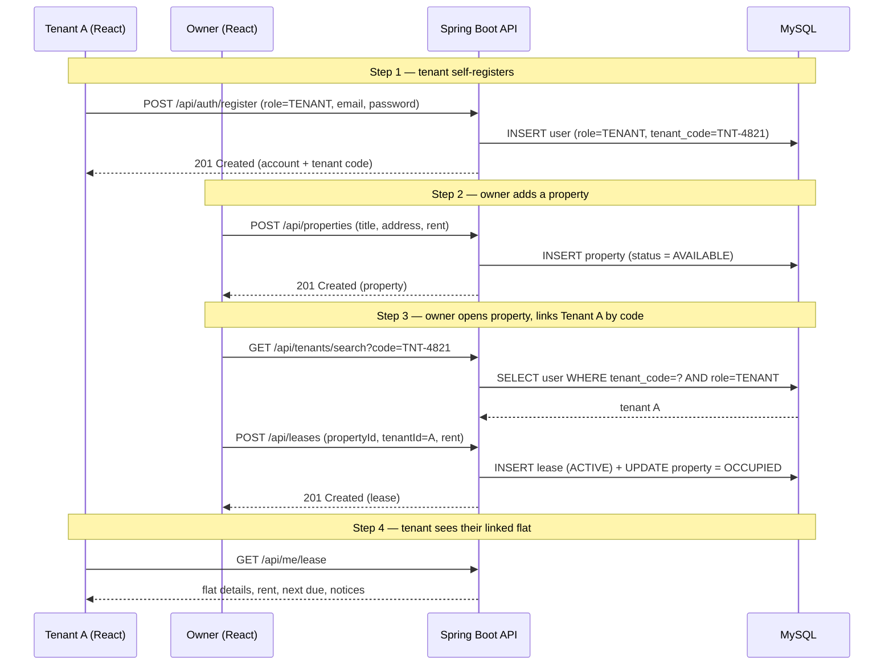
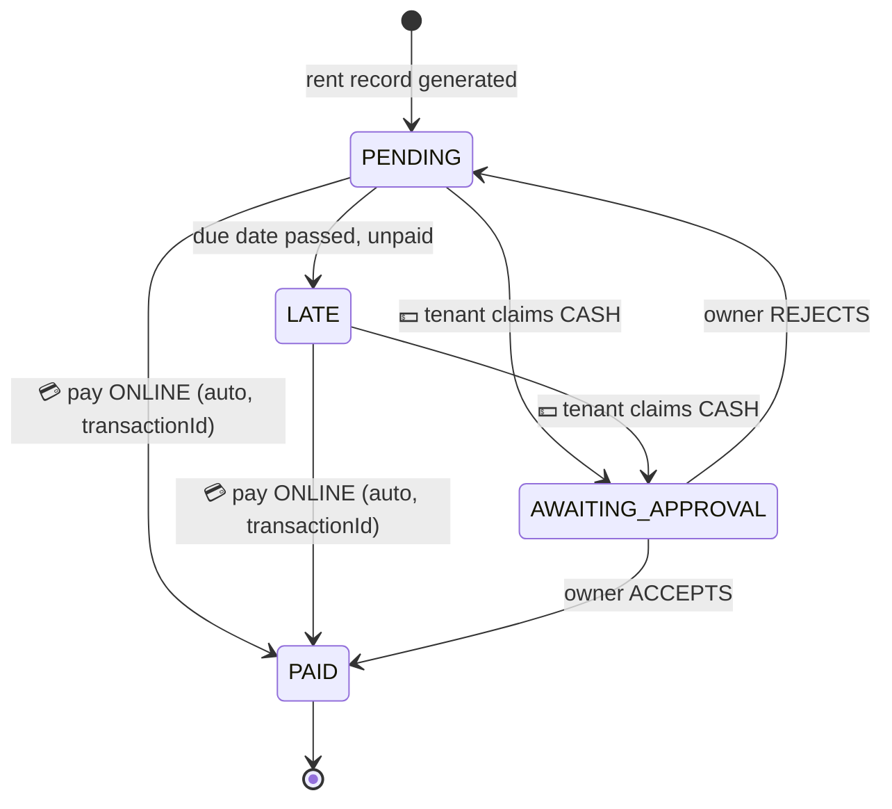
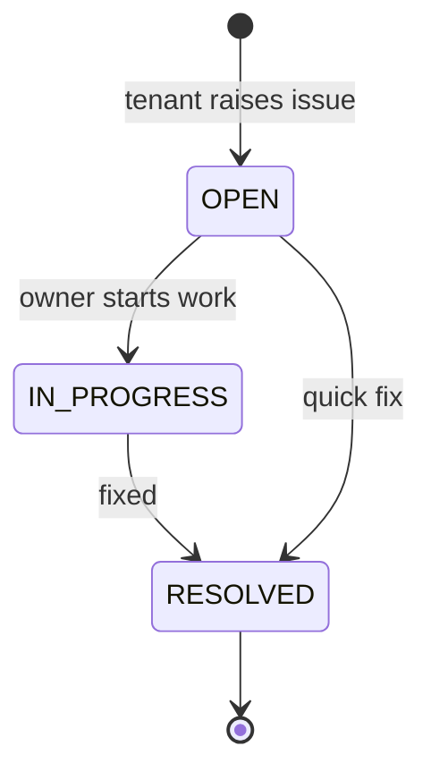
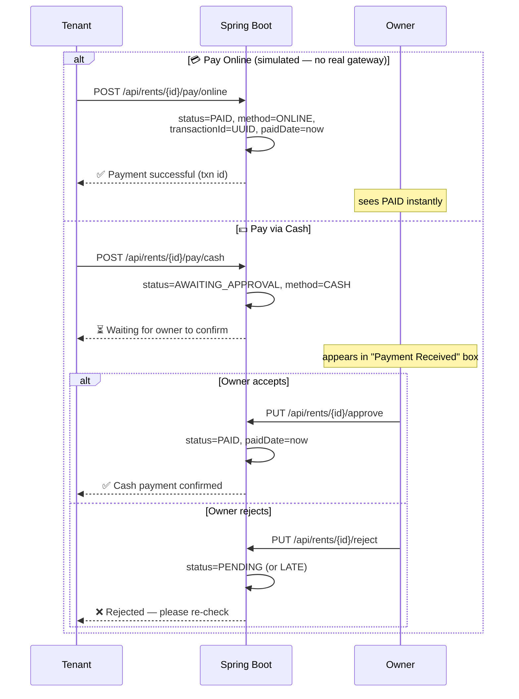

# 🏠 Tenant–Owner Management (TOM) — System Design

> Backend: **Spring Boot + MySQL** · Frontend: **React** · Style: simple & professional

This document is the blueprint we build from. It also maps every part to a **Spring Boot interview concept** so you learn while building.

---

## 0. Core Concept — Owner-Managed System

> ⚠️ **This is NOT a marketplace** (not like NoBroker / 99acres). Tenants do **not** browse or choose properties.

The **Owner is the admin** who controls everything. Tenants are participants the owner adds to the system.

### Who does what



**The core flow (your logic):**

1. **Tenant A self-registers** — creates their own account (name, email, password) and receives a **unique tenant code** in the format `"TNT-" + id` (e.g. `TNT-21`).
2. **Owner adds a property** (flat / room / building).
3. **Owner opens that property** and **adds Tenant A** to it (looked up by their **tenant code**) → this creates the **Lease** link (tenant ↔ property ↔ owner). Property becomes **OCCUPIED**.
4. **Tenant A logs in** and now sees the flat they're linked to — rent price, current dues, next due date, notices from the owner — and can **raise complaints** the owner sees under that property.

### Roles & Permissions

| Action                                        | Owner (Admin) |           Tenant            |
| --------------------------------------------- | :-----------: | :-------------------------: |
| Register self (sign-up)                       |      ✅       |             ✅              |
| Add / edit / delete property                  |      ✅       |             ❌              |
| Look up a tenant & link to a property (lease) |      ✅       |             ❌              |
| See linked flat details                       |       —       |             ✅              |
| Record / mark rent payments                   |      ✅       | 👀 view own dues / next due |
| Raise maintenance complaint                   |      ❌       |             ✅              |
| Update complaint status                       |      ✅       |         👀 view own         |
| Post notice                                   |      ✅       |           👀 view           |

### Scope — Core base first, features later

|                  | Module                                                   | When                                             |
| ---------------- | -------------------------------------------------------- | ------------------------------------------------ |
| 🟢 **Core base** | Users (owner + tenant) → Properties → Assignment (Lease) | **Build first & get working**                    |
| 🔵 Later         | Rent / monthly payments                                  | after core works                                 |
| 🔵 Later         | Maintenance complaints                                   | after core works                                 |
| 🔵 Later         | Notices                                                  | after core works                                 |
| 🔵 Later         | Amenities, property images, dashboard stats              | polish phase                                     |
| 🟢 **Core**      | Security — JWT login + data isolation                    | **required: each user sees only their own data** |

> We get **Owner → Property → Tenant → Lease** rock-solid first. Everything else plugs into that foundation.

---

## 1. High-Level Architecture



**Flow:** React sends HTTP requests → Controller receives → Service applies rules → Repository talks to MySQL → data returns as JSON.

---

## 2. Tech Stack

| Layer        | Technology                       | Why                                  |
| ------------ | -------------------------------- | ------------------------------------ |
| Frontend     | React + Axios + React Router     | Simple SPA, talks to REST            |
| Backend      | Spring Boot 3/4 (Web + Data JPA) | REST APIs + ORM                      |
| ORM          | Hibernate (via Spring Data JPA)  | Maps Java objects ↔ tables           |
| Database     | MySQL (local, `localhost:3306`)  | Free, relational, interview-relevant |
| Build        | Maven                            | Already set up                       |
| Auth (later) | Spring Security + JWT            | Roles: OWNER / TENANT                |

---

## 3. Data Model (Entities & Relationships)

### Entity Relationship Diagram



### Relationship summary (interview-important 👇)

> In JPA, a One-to-Many is **owned by the `@ManyToOne` side** (the table that holds the foreign key). Listed below by owning side.

| #   | Relationship                       | Type                   | Owning side (holds the FK)                                                   |
| --- | ---------------------------------- | ---------------------- | ---------------------------------------------------------------------------- |
| 1   | Owner (User) → Property            | One-to-Many            | `@ManyToOne` on Property (`owner_id`)                                        |
| 2   | Property → Lease                   | One-to-Many            | `@ManyToOne` on Lease (`property_id`)                                        |
| 3   | Tenant (User) → Lease              | One-to-Many            | `@ManyToOne` on Lease (`tenant_id`)                                          |
| 4   | Lease → RentPayment                | One-to-Many            | `@ManyToOne` on RentPayment (`lease_id`)                                     |
| 5   | Property → MaintenanceRequest      | One-to-Many            | `@ManyToOne` on Request (`property_id`)                                      |
| 6   | Tenant (User) → MaintenanceRequest | One-to-Many            | `@ManyToOne` on Request (`tenant_id`)                                        |
| 7   | Request → MaintenanceComment       | One-to-Many            | `@ManyToOne` on Comment (`request_id`)                                       |
| 8   | User → MaintenanceComment          | One-to-Many            | `@ManyToOne` on Comment (`user_id`)                                          |
| 9   | Owner (User) → Notice              | One-to-Many            | `@ManyToOne` on Notice (`owner_id`)                                          |
| 10  | Property → Notice (optional)       | One-to-Many            | `@ManyToOne` on Notice (`property_id`, nullable)                             |
| 11  | Property → PropertyAmenity         | One-to-Many collection | JPA `@ElementCollection` via `property_amenities` (`property_id`, `amenity`) |

> **Design choice 1 — the `LEASE` table:** we put an assignment table between Property and Tenant so a property's rental history is preserved over time. This is the record that **links tenant ↔ property ↔ owner** (owner is reached via `property.ownerId`). It's what makes rent tracking and reporting possible.
>
> **Design choice 2 — tenants self-register, owner links by code:** a `TENANT` is a `USER` with `role = TENANT` who **signs up on their own**. On registration the system generates a **unique tenant code** in the format **`"TNT-" + userId`** (e.g. user id `21` → `TNT-21`). The tenant shares this code with the owner, who **looks up the tenant by code** and links them to a property via a `LEASE`. "My tenants" = tenants who have an **ACTIVE lease** on one of my properties — derived through the lease, so no extra `ownerId` column on the user. Clean, normalized design.
>
> 💡 **Note (Phase 1 learning point):** since `userId` is auto-generated by the database on insert, the code is set in **two steps** — save the user first to get the id, then set `tenantCode = "TNT-" + id` and save again. This is a good `@Service` + `@Transactional` exercise.
>
> **Design choice 3 — role chosen at sign-up, whitelisted server-side:** the register form has a dropdown (OWNER / TENANT); the chosen `role` is sent in the request body (**Pattern A — one endpoint**). This is safe here because OWNER is a legitimate _account type_ (like buyer/seller) and **data isolation** means an owner only ever sees their own data — no privilege escalation over others. The service **whitelists** `role` to exactly `{OWNER, TENANT}` and rejects anything else (throws → 400). Server-generated fields (`id`, `tenantCode`, `createdAt`) are **never** trusted from the client. Role strings live in a `Constants` class (`static final`) to avoid magic strings.

> **Design choice 4 — property amenities:** amenities are optional, owner-entered names (for example, `Parking`, `Wi-Fi`, `Gym`). They are simple values, not standalone entities, so JPA stores them in a collection table using `@ElementCollection` rather than adding an amenities entity or a comma-separated column. `property_amenities` has one row per property/amenity pair and a composite primary key, and rows are removed with their property. Owners manage the list through the existing property create/update endpoints; there are no separate amenity CRUD endpoints. The tenant's active-lease response includes the property's amenity list.

---

## 4. Backend Layered Structure (package plan)

```
Tenant.Owner.Management.TOM
├── Entity/          → JPA @Entity classes (User, Property, Lease, ...)
├── Repository/      → interfaces extending JpaRepository
├── DTO/             → request/response objects (don't expose entities directly)
├── Service/         → business logic (@Service)
├── Controller/      → REST endpoints (@RestController)
├── Constants/       → shared constants (role strings, etc.)
├── exception/       → custom exceptions + @ControllerAdvice
└── config/          → CORS, security, etc.
```

> **Note on naming:** this project uses **Capitalized** package/folder names (`Entity`, `Service`, ...) consistently. The standard Java convention is lowercase package names; we stay consistent with the chosen style, and the package declaration in every file must match its folder (incl. case) or it breaks on case-sensitive Linux/CI.

**Why layers matter (interview answer):** separation of concerns — controllers handle HTTP, services handle rules, repositories handle data. Each is independently testable.

---

## 5. REST API Design (v1)

Base URL: `/api`

### Auth

| Method | Endpoint             | Description                                                            |
| ------ | -------------------- | ---------------------------------------------------------------------- |
| POST   | `/api/auth/register` | Register self as **owner** or **tenant** (password hashed with BCrypt) |
| POST   | `/api/auth/login`    | Verify credentials and return a short-lived Bearer JWT                 |

### Tenant lookup (Owner links existing tenants)

| Method | Endpoint                            | Description                                       |
| ------ | ----------------------------------- | ------------------------------------------------- |
| GET    | `/api/tenants/search?code=TNT-4821` | Owner finds a registered tenant by their **code** |
| GET    | `/api/tenants/{id}`                 | Tenant details                                    |

### Tenant self-service (their own view)

| Method | Endpoint          | Description                                                           |
| ------ | ----------------- | --------------------------------------------------------------------- |
| GET    | `/api/me/lease`   | My active linked property/lease, rent info, and property amenities    |
| GET    | `/api/me/rents`   | My total dues, next due date, unpaid breakdown, and full rent history |
| GET    | `/api/me/notices` | Notices for my property                                               |

`GET /api/me/rents` uses the authenticated tenant ID from the JWT; it does not accept a `tenantId` parameter. Its response is `TenantRentsResponse`:

| Field         | Meaning                                                                                                        |
| ------------- | -------------------------------------------------------------------------------------------------------------- |
| `totalDue`    | Sum of amount plus fine for unpaid rent (`PENDING`, `LATE`, or `AWAITING_APPROVAL`) across the tenant's leases |
| `nextDueDate` | Earliest due date among unpaid rent rows, or `null` when nothing is due                                        |
| `breakdown`   | Only unpaid rent rows, so the tenant can see what makes up the current balance                                 |
| `history`     | All rent rows, paid and unpaid, across the tenant's leases, ordered by due date descending                     |

### Properties (Owner)

| Method | Endpoint               | Description                                       |
| ------ | ---------------------- | ------------------------------------------------- |
| POST   | `/api/properties`      | Add property (optional `amenities` list)          |
| GET    | `/api/properties`      | List owner's properties, including amenities      |
| GET    | `/api/properties/{id}` | Property details, including amenities             |
| PUT    | `/api/properties/{id}` | Update property fields and replace amenities list |
| DELETE | `/api/properties/{id}` | Remove                                            |

**Amenities request example:**

```json
{
  "title": "Flat 12",
  "address": "12 Example Road",
  "type": "FLAT",
  "rentAmount": 1200.0,
  "description": "Two-bedroom flat",
  "amenities": ["Parking", "Wi-Fi", "Elevator"]
}
```

Amenity names are trimmed, case-insensitive duplicates are removed, blank names are rejected, and each name is limited to 100 characters. An omitted or empty list on property update clears the amenities.

### Leases / Assignment

| Method | Endpoint                        | Description               |
| ------ | ------------------------------- | ------------------------- |
| POST   | `/api/leases`                   | Assign tenant to property |
| GET    | `/api/leases/tenant/{tenantId}` | Tenant's lease            |
| PUT    | `/api/leases/{id}/end`          | End a lease               |

### Rent

| Method | Endpoint                     | Role         | Description                                          |
| ------ | ---------------------------- | ------------ | ---------------------------------------------------- |
| POST   | `/api/rents/generate`        | Owner/System | Generate monthly rent record (PENDING)               |
| GET    | `/api/rents/lease/{leaseId}` | Both         | Payment history                                      |
| POST   | `/api/rents/{id}/pay/online` | Tenant       | 💳 Simulated online pay → PAID + `transactionId`     |
| POST   | `/api/rents/{id}/pay/cash`   | Tenant       | 💵 Claim cash payment → AWAITING_APPROVAL            |
| GET    | `/api/rents/approvals`       | Owner        | Owner's "Payment Received" box (pending cash claims) |
| PUT    | `/api/rents/{id}/approve`    | Owner        | Accept cash payment → PAID                           |
| PUT    | `/api/rents/{id}/reject`     | Owner        | Reject cash claim → back to PENDING/LATE             |

### Maintenance

| Method | Endpoint                         | Description           |
| ------ | -------------------------------- | --------------------- |
| POST   | `/api/maintenance`               | Tenant raises issue   |
| GET    | `/api/maintenance/property/{id}` | Issues for a property |
| PUT    | `/api/maintenance/{id}/status`   | Owner updates status  |
| POST   | `/api/maintenance/{id}/comments` | Add comment           |

### Notices

| Method | Endpoint       | Description        |
| ------ | -------------- | ------------------ |
| POST   | `/api/notices` | Owner posts notice |
| GET    | `/api/notices` | View notices       |

### Dashboard

| Method | Endpoint               | Description                                |
| ------ | ---------------------- | ------------------------------------------ |
| GET    | `/api/dashboard/owner` | Totals: tenants, pending rent, open issues |

---

## 5B. Security & Data Isolation (JWT)

> 🔐 **Rule: every user sees ONLY their own data.** Owners see only their properties/tenants/rents; tenants see only their own lease/rents/complaints/notices.

### How login works (stateless JWT)



### Two layers of protection

| Layer                         | Question it answers                  | How                                                                      |
| ----------------------------- | ------------------------------------ | ------------------------------------------------------------------------ |
| **Authentication**            | _Who are you?_                       | Valid Bearer JWT required on every `/api/**` except `register` / `login` |
| **Authorization — role**      | _Are you allowed to do this action?_ | OWNER-only vs TENANT-only endpoints (role in token)                      |
| **Authorization — ownership** | _Is this row yours?_                 | Every query is filtered by the authenticated `userId` (data isolation)   |

### Data isolation rules (enforced in the Service layer)

| Who    | Can read                                                                                     | Scoped by                |
| ------ | -------------------------------------------------------------------------------------------- | ------------------------ |
| Owner  | their properties, their tenants, rents & complaints on their properties, notices they posted | `property.owner_id = me` |
| Tenant | their own lease, their rents/dues, their complaints, notices on their property               | `lease.tenant_id = me`   |

> **Never trust IDs from the client.** The `userId` comes from the **verified token**, not from a request param — otherwise a tenant could pass someone else's id and read their data. This is a classic **broken access control** (OWASP #1) pitfall interviewers probe.

### Key security decisions

- **Passwords hashed with BCrypt** — new registrations store only BCrypt hashes. Existing plaintext passwords are upgraded to BCrypt after a successful login.
- **JWT is stateless** — server sessions are disabled. A verified token carries the user ID as `sub`, plus `role` and `email`.
- **Token expiry** — access tokens expire after four hours; the user logs in again after expiry.
- **Signing algorithm** — HS256 with an HMAC key containing at least 32 random bytes.
- **Secret key** — read from the Base64-encoded `JWT_SECRET` environment variable; it has no committed default and must never be committed.
- **Role authorization** — Spring Security allows only OWNER or TENANT roles on the routes designed for them; unlisted routes are denied.
- **Identity and ownership** — controllers take the user ID from the verified JWT principal, never from an `ownerId` or `tenantId` request parameter. Service/repository queries remain scoped to that ID.
- **Login response** — `{ accessToken, tokenType: "Bearer", expiresIn, user }`; the password/hash is never returned.

Generate a local signing secret in PowerShell before starting the app:

```powershell
$bytes = New-Object byte[] 32
$rng = [System.Security.Cryptography.RandomNumberGenerator]::Create()
$rng.GetBytes($bytes)
$env:JWT_SECRET = [Convert]::ToBase64String($bytes)
$rng.Dispose()
mvn spring-boot:run
```

---

## 6. Key Workflows

### 6.1 Core flow — tenant registers, owner links them to a property



### 6.2 Rent payment lifecycle (online vs cash)



### 6.3 Maintenance request lifecycle



### 6.4 Rent payment — online (simulated) vs cash (owner approval)



> **Online = simulated:** no real payment API. The backend just sets `status = PAID` and generates a random `transactionId` (UUID) so it _looks_ like a real transaction. **Cash = trust-but-verify:** the tenant claims they paid, and the owner must accept/reject before it counts as PAID.

> **💡 Future enhancement — real Razorpay (test mode):** the simulated online path can later be replaced by Razorpay test mode. Flow: backend **creates an order** (Razorpay Orders API) → React opens the **Checkout widget** (test card) → Razorpay returns `payment_id` + `signature` → backend **verifies the HMAC-SHA256 signature** with the secret, and only _then_ marks `PAID`. Needs the React UI (checkout is browser-side), so it's a Phase 9 / extra task. No real money in test mode.

### 6.5 Monthly rent auto-generation (anniversary-based scheduling)

Rent is billed **in arrears** on **each tenant's own anniversary day** (the day-of-month of the lease `startDate`), **not** a fixed calendar date. A tenant who moves in on **12 Jan** completes their first month on **12 Feb** — the bill is generated **on 12 Feb** (the cycle-end / anniversary) for the month just lived, and is **due that day**. The **first bill therefore appears one month after move-in**; subsequent bills on the 12th of each following month.

Because tenants bill on **different days**, a **daily** job runs every night and handles both generation and fines:

```java
@Scheduled(cron = "0 0 0 * * *")   // every day at 00:00
public void dailyRentJob() {
    // A) GENERATION (arrears) — for each ACTIVE lease whose anniversary day == today
    //      AND startDate <= (today - 1 month), i.e. at least one full month completed:
    //      if no rent_payment exists for (leaseId, forMonth=cycle just completed):
    //        INSERT rent_payment(status=PENDING, amount=lease.monthlyRent,
    //                            forMonth=YYYY-MM, dueDate=today)
    // B) FINE + LATE — for each unpaid rent past (dueDate + lease.fineGraceDays):
    //      daysLate = today - dueDate
    //      fine     = max(0, daysLate - fineGraceDays) * finePerDay
    //      status   = LATE
}
```

**Rules & design decisions:**

- Requires `@EnableScheduling` + `@Scheduled(cron=...)`. Job runs **daily** (not monthly) because billing days differ per lease.
- **Billing model = arrears.** The bill is generated on the anniversary (the **end** of each completed month) for the month just lived, and is due that same day. First bill = `startDate + 1 month`.
- **Billing day = day-of-month of `startDate`.** Cycle N covers `[startDate + N months, startDate + (N+1) months)`, billed at its end.
- **Month-end clamping:** if the `startDate` day doesn't exist in a month (e.g. 31 Jan → February), **clamp to the last day of that month** (Feb 28/29).
- **Only ACTIVE leases** generate rent (skip ENDED).
- **Idempotent:** check no row exists for `(leaseId, forMonth)` before inserting; DB **unique constraint** on `(lease_id, for_month)` backs it up. Safe on restart/retry.
- **Manual fallback kept:** `POST /api/rents/generate` for testing / manual trigger.

**Owner-configured fine (per lease):** the owner sets `fineGraceDays` and `finePerDay` when creating the lease.

```
daysLate = today − dueDate
fine     = max(0, daysLate − fineGraceDays) × finePerDay
```

> Example: due **12 Feb**, grace **5 days**, ₹100/day → free until **17 Feb**; **18 Feb** → ₹100; **20 Feb** → ₹300 (while unpaid).

> **Interview value:** `@Scheduled` daily cron, anniversary/date math with **month-end clamping**, per-entity configurable business rules (grace + fine), and idempotent generation (unique `lease_id + for_month`).

### 6.6 Carry-forward dues (unpaid rent accumulates)

If a tenant doesn't pay one cycle's rent (₹12,000), the next cycle generates another PENDING row (₹12,000) — so the tenant owes **₹24,000** across two rows, **plus any accrued fines**.

```
rent_payment rows for lease 5 (moved in 12 Jan, ₹12,000/mo, grace 5d, ₹100/day):
  2026-01  ₹12,000  + fine  LATE      ← unpaid since 12 Jan, fine accruing
  2026-02  ₹12,000          PENDING   ← new cycle billed 12 Feb
```

**Key design decision — the total is COMPUTED, never stored:**

- **No `total_due` column.** The outstanding balance is derived on the fly:
  ```
  totalDue = SUM(amount + fine)
             WHERE lease_id = ? AND status IN (PENDING, LATE, AWAITING_APPROVAL)
  ```
- The **breakdown** = the list of unpaid rows themselves (each `for_month` is a line item, with its own accrued `fine`).
- Storing a running total would go stale/inconsistent on every payment or fine tick → violates normalization. **The rows are the single source of truth.**
- **Backend computes** the total + breakdown and returns a `DuesResponse { totalDue, breakdown[], nextDueDate }` via `GET /api/me/rents`. The **UI only displays** it — never does the money math (financial logic must not be trusted to the client).

> **Interview one-liner:** _"Aggregates like total dues are derived by summing unpaid rent rows (`SUM WHERE status != PAID`), not stored — a stored total would go stale and violate normalization. Each month is its own row; the backend computes the balance, fines, and breakdown, the UI only renders."_

---

## 7. Frontend Pages (React)

| Page             | Role   | Purpose                                                    |
| ---------------- | ------ | ---------------------------------------------------------- |
| Login / Register | Both   | Enter system                                               |
| Owner Dashboard  | Owner  | Totals + quick links                                       |
| Properties       | Owner  | CRUD properties and amenity lists                          |
| Tenants / Leases | Owner  | Assign & view tenants                                      |
| Rent             | Owner  | Track/mark payments                                        |
| Maintenance      | Both   | Raise / manage issues                                      |
| Notices          | Both   | Post / read announcements                                  |
| Tenant Dashboard | Tenant | My rent, my issues, notices, and linked-property amenities |

Keep UI clean: a sidebar + top bar + cards/tables. No heavy animations.

---

## 8. Build Roadmap (phased)

> 🟢 = **core base** (build first, get fully working) · 🔵 = features added later · ⚪ = optional

| Phase                                                   | Goal                                                                           | Spring Boot concepts learned                                              |
| ------------------------------------------------------- | ------------------------------------------------------------------------------ | ------------------------------------------------------------------------- |
| 🟢 **0. Setup**                                         | Connect Spring Boot ↔ MySQL                                                    | `application.properties`, datasource, `mysql-connector-j`                 |
| 🟢 **1. Users**                                         | Owner entity + create tenants, roles                                           | `@Entity`, `JpaRepository`, DTOs, `@RestController`                       |
| 🟢 **2. Properties**                                    | Full CRUD (add/edit/update/delete)                                             | REST design, `@Service`, validation, exception handling                   |
| 🟢 **3. Leases**                                        | Link tenant ↔ property                                                         | Entity relationships (`@ManyToOne`), transactions (`@Transactional`)      |
| 🔵 **4. Rent**                                          | Monthly payment tracking + auto-generation (`@Scheduled`) + carry-forward dues | Business logic, dates, status enums, cron scheduling, computed aggregates |
| 🔵 **5. Maintenance**                                   | Complaint tracking                                                             | One-to-many, nested resources                                             |
| 🔵 **6. Notices + Dashboard**                           | Announcements + stats                                                          | Aggregation queries (`@Query`)                                            |
| 🔵 **7. Extras**                                        | Property amenities and images                                                  | `@ElementCollection` for amenity names; file handling for images          |
| 🟢 **8. Security**                                      | JWT login + role & ownership checks                                            | Spring Security, filters, JWT, BCrypt                                     |
| 🔵 **9. React UI**                                      | Connect frontend                                                               | CORS, Axios, REST integration                                             |
| 💡 **10. AI Assistant** _(future idea — not finalized)_ | Natural-language Q&A over the user's own data                                  | LLM function/tool calling, intent → safe scoped query                     |

**We stop and celebrate after Phase 3** — that's your working core base (Owner → Property → Tenant → Lease). Everything after is additive.

> **💡 Phase 10 is an exploratory idea, not a committed feature** — see the "Future Idea" section below for the sketch.

---

## 💡 Future Idea — AI Assistant (LLM chatbot) — _exploratory, not finalized_

> ⚠️ **Status: just an idea.** Captured here so the thinking isn't lost. Not designed in detail, not committed. Would be built **last** (needs Phase 8 auth + Phase 9 UI first).

**Concept:** a chat assistant where a tenant or owner asks natural-language questions about **their own** data, and an LLM produces a friendly answer backed by real queries.

**Example questions:**

- _"How much total fine have I paid till date?"_
- _"In June, on which date did I pay the rent?"_
- _"Which of my properties has the highest rent?"_
- _"Which tenant usually pays me late?"_ (owner only)

**Proposed flow:**

```
React (question + JWT) → Spring Boot (auth + tools) → LLM service (Python/FastAPI or Spring AI)
   → LLM picks a TOOL + args (not raw SQL) → Spring runs the SAFE, user-scoped query on MySQL
   → data back to LLM → LLM phrases a natural-language answer → back to user
```

**Key design decisions (if/when built):**

- **Function/tool calling, NOT text-to-SQL.** The LLM only chooses from a fixed set of backend functions (`getTotalFine(userId)`, `getRentPaidDate(userId, month)`, `getHighestRentProperty(ownerId)`, `getLateTenants(ownerId)`...). The LLM **never** writes or runs SQL — avoids injection, wrong queries, and data leakage.
- **🔒 Data isolation is mandatory.** Every tool is scoped by the authenticated `userId` + `role` from the JWT. The LLM decides _intent_; the **backend enforces authorization**. A tenant can never reach another user's data via a cleverly-worded question; owner-only questions are rejected for tenants.
- **Backend runs the query, not the model.** The model gets only the resulting data to phrase — never direct DB access.
- **Implementation options:** (a) Python microservice via HTTP (FastAPI), or (b) **Spring AI / LangChain4j** in-process (one Java stack, fewer hops). Either works.
- **Guardrails:** validate the LLM's tool choice against the allow-list; reject off-list; cache common answers; rate-limit (LLM calls cost money + latency).

**Interview value:** LLM function-calling, intent vs authorization separation, safe AI-over-database design, microservice integration.

### Full project structure (3 apps — monorepo)

The finished system is **three independent apps** that run separately and talk over HTTP/REST:

```
React (frontend) :3000  →  Spring Boot (backend) :8080  →  MySQL :3306
                                     │
                                     └──►  Python AI service (future) :8000  →  LLM API
```

| App        | Tech               | Port | Role                                   |
| ---------- | ------------------ | ---- | -------------------------------------- |
| Frontend   | React              | 3000 | UI (forms, dashboards, chat)           |
| Backend    | Spring Boot (Java) | 8080 | REST API, business logic, DB, JWT auth |
| AI service | Python / FastAPI   | 8000 | LLM function-calling (future)          |
| Database   | MySQL              | 3306 | data                                   |

**Recommended monorepo layout** (reorganize in Phase 9 — not now):

```
TOM/                    ← one Git repo
├── backend/            ← Spring Boot :8080  (current project moves here in Phase 9)
├── frontend/           ← React :3000
├── ai-service/         ← Python/FastAPI :8000 (future)
└── docs/               ← DESIGN / PROGRESS / INTERVIEW-NOTES
```

Each folder is its own app (own build/run). Java and Python **cannot** share a process — the AI piece is always a separate service called over HTTP. Alternative to Python: **Spring AI / LangChain4j** in-process (one Java stack, no second server).

**React ↔ Spring Boot (Phase 9):** React calls the API via axios; backend enables **CORS** for `http://localhost:3000` (a `@Configuration`), and the `?ownerId=` query param is **replaced by the JWT** identity.

### Why Python for the AI service (rationale)

- Python is **in high demand** and the **AI/LLM ecosystem is Python-first** (LangChain, LlamaIndex, OpenAI SDK, Hugging Face, FastAPI).
- Showcases **polyglot / full-stack range**: Java (Spring Boot) + Python (AI) + React — stronger portfolio than a single-stack project.
- Demonstrates **microservice integration** across languages over REST.
- The Python service should do **real work** (FastAPI, LLM integration, prompt/tool orchestration, typing/async) — not a thin proxy — so it meaningfully shows Python skill.

**Resume story:** _"Full-stack property-management platform — Spring Boot REST backend (JPA, transactions, JWT), React frontend, and a Python/FastAPI AI microservice using LLM function-calling to answer natural-language questions over the user's data, with enforced data isolation."_

---

## 9. Spring Boot Interview Concept Map

As you build, you'll be able to confidently explain:

- **IoC & Dependency Injection** — `@Autowired`, constructor injection
- **Bean lifecycle & stereotypes** — `@Component`, `@Service`, `@Repository`, `@Controller`
- **Spring Data JPA** — `JpaRepository`, derived queries, `@Query`, pagination
- **Entity relationships** — one-to-many, many-to-one, fetch types (LAZY vs EAGER), cascade
- **DTO pattern** — why not expose entities directly
- **Exception handling** — `@ControllerAdvice`, `@ExceptionHandler`
- **Validation** — `@Valid`, `@NotNull`, Bean Validation
- **Transactions** — `@Transactional`, ACID
- **REST principles** — status codes, resource naming, statelessness
- **Configuration** — `application.properties`, profiles, `@Value`
- **Security** — authentication vs authorization, JWT, password hashing

---

## 10. Next Step

**Phase 0 — Connect to MySQL (database-first).** We'll:

1. Add the MySQL driver dependency to `pom.xml`.
2. **Manually create** the database + core tables in MySQL Workbench (`users`, `properties`, `leases`).
3. Configure `application.properties` with your connection + `spring.jpa.hibernate.ddl-auto=validate`.
4. Build entities that map to the existing tables; Hibernate **validates** the mapping on boot (it never creates/alters tables).

> **Approach: database-first.** You own the schema in MySQL Workbench. Spring Boot maps to it and validates — so if an entity field doesn't match a column, the app fails fast with a clear error. Great for learning JPA mapping precisely.

```

```
